# RAG Backend Pipeline Architecture & Flows

Welcome to the **RAG Backend Pipeline Documentation**. This directory contains detailed flow charts and technical breakdowns for each pipeline component in the backend, synchronized with the latest codebase.

---

## 📐 System Architecture Overview

```mermaid
flowchart TD
    subgraph Client ["Client / Frontend"]
        UserUI["User Interface / SSE Listener"]
    end

    subgraph API ["FastAPI Router & Endpoints (app/api/)"]
        DocAPI["/api/v1/documents"]
        ThreadAPI["/api/v1/threads"]
        SSEHub["SSE Publisher (app/core/sse.py)"]
    end

    subgraph Ingestion ["Ingestion Subsystem (app/workers/ & app/rag/)"]
        Worker["Background Ingestion Worker (app/workers/ingestion.py)"]
        Loader["LoaderFactory & Detectors (PDF, Text, CSV)"]
        Chunker["ChunkerFactory (Recursive, Character, Markdown, Semantic)"]
        Embedder["SentenceTransformerEmbedder"]
        PgVector["PgVectorStore (pgvector extension)"]
    end

    subgraph QueryEngine ["Query Execution Subsystem (app/rag/)"]
        Engine["QueryEngine (app/rag/engine.py)"]
        QPipeline["QueryPipeline Orchestrator (app/rag/pipeline/query.py)"]
        Executor["PipelineStepExecutor (app/rag/pipeline/executor.py)"]
        Memory["MemoryManager & ThreadSummarizer (app/rag/memory/)"]
        Transformer["QueryTransformationProcessor (app/rag/query/)"]
        Retrieval["RetrievalWorkflow (Dense, Sparse, Hybrid, MMR)"]
        Reranker["CrossEncoderReranker (app/rag/reranking/)"]
        PromptBuilder["Context & Prompt Builder (app/rag/memory/context.py)"]
        LLM["ProviderModelFactory (Groq, Gemini, OpenAI)"]
        CancelMgr["CancellationManager (app/core/cancellation.py)"]
    end

    subgraph DB ["PostgreSQL Database"]
        Postgres["AsyncSession DB (Documents, KBs, Threads, Messages, Runs, RunSteps, ModelCalls)"]
    end

    %% Ingestion Flow Connections
    DocAPI -->|1. Upload File & Create Pending Doc| Postgres
    DocAPI -->|2. Dispatch Background Task| Worker
    Worker -->|3. Lock & Load File| Loader
    Worker -->|4. Split Document| Chunker
    Worker -->|5. Generate Batch Vectors| Embedder
    Worker -->|6. Store Embeddings & Chunks| PgVector
    Worker -->|SSE Events: loading, loaded, chunking, chunked, embedding, stored, completed| SSEHub
    SSEHub -.->|Real-time SSE Updates| UserUI

    %% Query Flow Connections
    ThreadAPI -->|1. Post Message / Stream| Engine
    Engine -->|2. Execute RAG Pipeline| QPipeline
    QPipeline -->|3. Check User Cancellation| CancelMgr
    QPipeline -->|4. Load Memory & Progressive Summary| Memory
    QPipeline -->|5. Transform Query| Transformer
    QPipeline -->|6. Multi-KB Search| Retrieval
    Retrieval <-->|Vector Cosine & BM25 Search| PgVector
    QPipeline -->|7. Cross-Encoder Scoring| Reranker
    QPipeline -->|8. Assemble RAG Prompt| PromptBuilder
    QPipeline -->|9. Generate / Stream Tokens| LLM
    QPipeline -->|Record Execution Steps| Executor
    Engine -->|10. Persist Assistant Message, Run, Steps & ModelCall| Postgres
    Engine -.->|Streaming Tokens & Step Events| UserUI
```

---

## 🗂 Pipeline Flow Index

Click on any pipeline below to view its full Mermaid diagram and detailed technical execution workflow:

1. 📥 [**Document Ingestion Pipeline**](ingestion_pipeline.md)
   - Covers document upload, file type detection, file loaders (`pdf`, `text`, `csv`), chunking strategies (`recursive`, `character`, `markdown`, `semantic`), batch vector embedding generation, vector store persistence, rich chunk metadata, and real-time SSE progress event streams.

2. 🔍 [**Query Execution Pipeline**](query_pipeline.md)
   - Covers message request handling, `ThreadConfig` validation, progressive conversation summary compaction, query transformation, multi-KB candidate retrieval, cross-encoder reranking against anchor queries, prompt context assembly with citation enforcement, LLM token streaming, cancellation management, and durable PostgreSQL audit persistence (`RunStep` & `ModelCall`).

3. 🔎 [**Retrieval Workflow Pipeline**](retrieval_pipeline.md)
   - Detailed breakdown of Knowledge Base embedding model grouping, dense vector inner product search, sparse BM25 keyword search, candidate deduplication (`deduplicate_scored`), hybrid weighted score fusion ($\alpha$), and Maximal Marginal Relevance (MMR) candidate diversity optimization.

4. 🔄 [**Query Transformation Pipeline**](query_transformation_pipeline.md)
   - Detailed breakdown of `QueryTransformationProcessor` strategy registration and execution: `none` (`PassThrough`), `rewrite` (`QueryRewriter`), `hyde` (`HyDETransformer`), `multi_query` (`MultiQueryExpander`), `step_back` (`StepBackTransformer`), and `sub_queries` (`SubQueryDecomposer`), along with legacy field normalization and fallback mechanisms.

---

## 🛠 Tech Stack & Key Components

| Subsystem | Components | Primary File Paths |
| :--- | :--- | :--- |
| **Ingestion Worker** | Background Task Worker & Ingestion Pipeline Orchestrator | [`app/workers/ingestion.py`](../app/workers/ingestion.py) [`app/rag/pipeline/ingestion.py`](../app/rag/pipeline/ingestion.py) |
| **Document Loaders** | File Detector, Factory, & Multi-Format Loaders | [`app/rag/loaders/detector.py`](../app/rag/loaders/detector.py) [`app/rag/loaders/factory.py`](../app/rag/loaders/factory.py) [`app/rag/loaders/registry.py`](../app/rag/loaders/registry.py) |
| **Chunking Strategies** | Chunker Factory, Splitters & Document Compatibility | [`app/rag/chunking/factory.py`](../app/rag/chunking/factory.py) [`app/rag/chunking/splitter.py`](../app/rag/chunking/splitter.py) |
| **Vector Embeddings** | SentenceTransformer Model Embedder & Model Registry | [`app/rag/embeddings/sentence_transformer.py`](../app/rag/embeddings/sentence_transformer.py) [`app/core/model_config.py`](../app/core/model_config.py) |
| **Vector Store** | PostgreSQL `pgvector` Vector Store & Chunks Integration | [`app/rag/vectorstore/pgvector.py`](../app/rag/vectorstore/pgvector.py) |
| **Query Engine** | Run Lifecycle, Query Pipeline & Step Executor | [`app/rag/engine.py`](../app/rag/engine.py) [`app/rag/pipeline/query.py`](../app/rag/pipeline/query.py) [`app/rag/pipeline/executor.py`](../app/rag/pipeline/executor.py) |
| **Memory & Context** | Memory Manager, Thread Summarizer & Context Builder | [`app/rag/memory/manager.py`](../app/rag/memory/manager.py) [`app/rag/memory/summarizer.py`](../app/rag/memory/summarizer.py) [`app/rag/memory/context.py`](../app/rag/memory/context.py) |
| **Query Transformers**| Transformation Processor & Strategy Classes | [`app/rag/query/processor.py`](../app/rag/query/processor.py) [`app/rag/query/transformer.py`](../app/rag/query/transformer.py) |
| **Retrieval Subsystem**| Retrieval Workflow, Dense, Sparse, Hybrid, & MMR | [`app/rag/retrieval/workflow.py`](../app/rag/retrieval/workflow.py) [`app/rag/retrieval/fusion.py`](../app/rag/retrieval/fusion.py) [`app/rag/retrieval/mmr.py`](../app/rag/retrieval/mmr.py) |
| **Reranker Engine** | CrossEncoder Model Registry & Anchor Query Reranker | [`app/rag/reranking/reranker.py`](../app/rag/reranking/reranker.py) |
| **LLM Generation** | Provider Registry & Providers (Groq, Gemini, OpenAI) | [`app/rag/generation/factory.py`](../app/rag/generation/factory.py) [`app/rag/generation/base.py`](../app/rag/generation/base.py) |
| **Cancellation & SSE** | Async Run Cancellation & SSE Publisher | [`app/core/cancellation.py`](../app/core/cancellation.py) [`app/core/sse.py`](../app/core/sse.py) |
