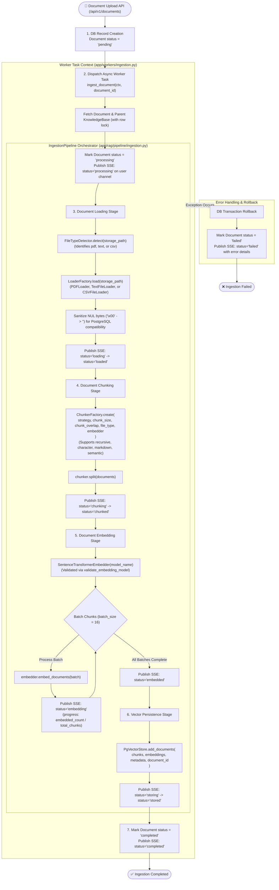

# Document Ingestion Pipeline Flow

The **Document Ingestion Pipeline** processes raw files uploaded to a Knowledge Base. It handles file type detection, content extraction, chunking strategy resolution, vector embedding generation, PostgreSQL `pgvector` persistence, and real-time Server-Sent Events (SSE) status publishing.

---

## 📊 Ingestion Pipeline Flowchart

---

## 🔬 Detailed Step-by-Step Breakdown

### 1. Document Upload & Task Dispatch
- **Endpoint**: [`POST /api/v1/documents`](../app/api/documents.py)
- **Action**: Validates file payload, writes uploaded file to disk storage, creates a database `Document` record with `status="pending"`, and dispatches the background ingestion task.

### 2. Worker Initialization & Lock
- **Module**: [`app/workers/ingestion.py`](../app/workers/ingestion.py)
- **Action**: 
  - Retrieves the `Document` with a row-level DB lock (`with_for_update()`) and resolves its parent `KnowledgeBase`.
  - Determines the target SSE channel (`ingestion_channel:{user_id}` or `ingestion_channel`).
  - Updates document status to `processing` and emits SSE event `ingestion_status` (`status: "processing"`).

### 3. File Type Detection & Loading
- **Modules**: [`app/rag/loaders/detector.py`](../app/rag/loaders/detector.py), [`app/rag/loaders/factory.py`](../app/rag/loaders/factory.py), [`app/rag/loaders/registry.py`](../app/rag/loaders/registry.py)
- **Action**:
  - `FileTypeDetector` inspects the file extension / MIME type to classify the format (`pdf`, `text`, or `csv`).
  - `LoaderFactory` fetches the registered loader (`PDFLoader`, `TextFileLoader`, or `CSVFileLoader`) from `LoaderRegistry`.
  - Content is extracted into LangChain `Document` objects and sanitized by stripping NUL bytes (`\x00`) to prevent PostgreSQL text column errors.
  - Emits SSE status events: `loading` followed by `loaded` (with total `document_count`).

### 4. Text Chunking & Strategy Resolution
- **Modules**: [`app/rag/chunking/factory.py`](../app/rag/chunking/factory.py), [`app/rag/chunking/splitter.py`](../app/rag/chunking/splitter.py)
- **Action**:
  - `ChunkerFactory` evaluates the Knowledge Base `chunking_config` (`strategy`, `chunk_size`, `chunk_overlap`) against document type compatibility rules.
  - Supported strategies:
    - `recursive`: `RecursiveChunker` (default, standard text/PDF hierarchy).
    - `character`: `CharacterChunker` (separator-based splitting).
    - `markdown`: `MarkdownChunker` (header-aware structure splitting).
    - `semantic`: `SemanticChunker` (embedding-based semantic breakpoint splitting).
  - Validates compatibility (e.g. falls back to `recursive` if `markdown` or `semantic` strategies are incompatible with tabular `csv`).
  - Emits SSE status events: `chunking` followed by `chunked` (with total `chunk_count`).

### 5. Vector Embedding Generation
- **Modules**: [`app/rag/embeddings/sentence_transformer.py`](../app/rag/embeddings/sentence_transformer.py), [`app/core/model_config.py`](../app/core/model_config.py)
- **Action**:
  - Validates requested embedding model via `validate_embedding_model()`.
  - Instantiates `SentenceTransformerEmbedder` for the Knowledge Base model configuration (e.g. `all-MiniLM-L6-v2`).
  - Processes chunk text in batches (`batch_size = 16`).
  - Emits SSE progress notifications per batch (`embedded_count` / `total_chunks`) and final `embedded` event.

### 6. Vector Store & Rich Metadata Persistence
- **Module**: [`app/rag/vectorstore/pgvector.py`](../app/rag/vectorstore/pgvector.py)
- **Action**:
  - Inserts document chunks, vector embeddings, and metadata into PostgreSQL using `pgvector`.
  - Attaches rich chunk metadata:
    - `filename`, `type` (MIME type), `file_type`, `size_bytes`, `storage_path`
    - `knowledge_base_id`, `embedding_model`, `embedding_dimension`
    - `chunking_strategy`, `chunking_config`
  - Emits SSE status events: `storing` followed by `stored`.

### 7. Completion & SSE Notification Stream
- Updates database `Document` status to `completed`.
- Emits final SSE event `ingestion_status` (`status: "completed"`).
- In case of failure: rolls back DB transaction, sets `status = "failed"`, and emits SSE event with the exception error message.
