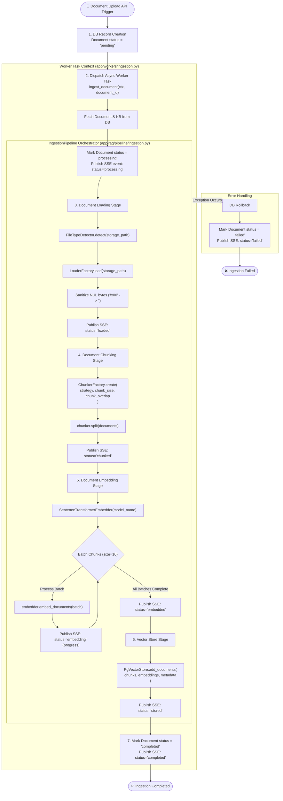

# Document Ingestion Pipeline Flow

The **Ingestion Pipeline** handles raw document processing, text extraction, chunking, vector embedding, and storage into PostgreSQL using `pgvector`. It also provides real-time SSE progress updates to the client.

---

## 📊 Ingestion Pipeline Flowchart

---

## 🔬 Detailed Step-by-Step Breakdown

### 1. Document Upload & Task Dispatch
- **Endpoint**: [`POST /api/v1/documents`](../app/api/documents.py)
- **Action**: Validates user upload, writes raw file to storage, creates a database record with `status="pending"`, and dispatches the background task to the ingestion worker.

### 2. Worker Initialization & DB Context
- **Module**: [`app/workers/ingestion.py`](../app/workers/ingestion.py)
- **Action**: 
  - Retrieves the `Document` and parent `KnowledgeBase` configuration (embedding model, chunking parameters).
  - Updates status to `processing`.
  - Emits SSE event: `ingestion_status` with `status: "processing"`.

### 3. File Type Detection & Loading
- **Module**: [`app/rag/loaders/`](../app/rag/loaders/)
- **Action**:
  - `FileTypeDetector` inspects file extension/MIME type.
  - `LoaderFactory` instantiates appropriate loader (`PDFLoader`, `DocxLoader`, `TextLoader`, etc.).
  - Extracts text content and sanitizes NULL bytes (`\x00`) to prevent PostgreSQL text column errors.
  - Emits SSE event: `status: "loaded"`.

### 4. Text Chunking
- **Module**: [`app/rag/chunking/`](../app/rag/chunking/)
- **Action**:
  - `ChunkerFactory` instantiates configured strategy (e.g. `RecursiveChunker`, `SemanticChunker`, `TokenChunker`).
  - Splits loaded documents into chunks based on `chunk_size` and `chunk_overlap`.
  - Emits SSE event: `status: "chunked"`.

### 5. Vector Embedding Generation
- **Module**: [`app/rag/embeddings/sentence_transformer.py`](../app/rag/embeddings/sentence_transformer.py)
- **Action**:
  - `SentenceTransformerEmbedder` processes chunks in batches (default `batch_size = 16`).
  - Emits progress SSE events for each batch (`embedded_count` / `total_chunks`).
  - Emits SSE event: `status: "embedded"`.

### 6. PgVector Database Persistence
- **Module**: [`app/rag/vectorstore/pgvector.py`](../app/rag/vectorstore/pgvector.py)
- **Action**:
  - Inserts vector embeddings, chunk text, and rich metadata into PostgreSQL `vector` table.
  - Attached Metadata includes: `filename`, `file_type`, `size_bytes`, `knowledge_base_id`, `embedding_model`, `embedding_dimension`, `chunking_strategy`, and `chunking_config`.
  - Emits SSE event: `status: "stored"`.

### 7. Completion & SSE Event Stream
- Updates database document record `status="completed"`.
- Emits final SSE event `status: "completed"`.
