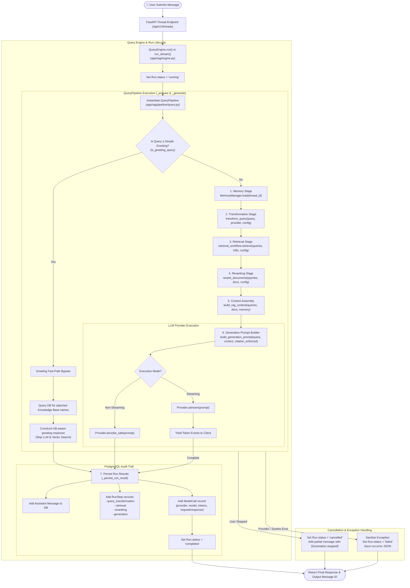

# Query Execution Pipeline Flow

The **Query Execution Pipeline** coordinates the end-to-end RAG workflow for user queries: greeting fast-pathing, chat history loading, query transformation, multi-knowledge-base retrieval, cross-encoder reranking, prompt context assembly, LLM response generation (or token streaming), and durable run step logging.

---

## 📊 Query Execution Pipeline Flowchart

---

## 🔬 Detailed Step-by-Step Breakdown

### 1. Engine & Pipeline Initialization
- **Classes**: [`QueryEngine`](../app/rag/engine.py), [`QueryPipeline`](../app/rag/pipeline/query.py)
- **Action**:
  - Resolves `PipelineVersion` and active `ThreadConfig`.
  - Instantiates LLM generation provider via `ProviderModelFactory`.
  - Initializes `MemoryManager`, `PgVectorStore`, `RetrievalWorkflow`, and `PipelineStepExecutor`.

### 2. Fast-Path Greeting Bypass
- **Function**: `is_greeting_query(query)`
- **Logic**:
  - Detects simple greetings (e.g., *"hi"*, *"hello"*, *"good morning"*).
  - Skips vector search and LLM calls to optimize latency and token costs.
  - Queries database for attached Knowledge Base names and returns an instant response (e.g., *"Hi! What would you like to get info from your knowledge base containing **Docs**?"*).

### 3. Memory Stage
- **Module**: [`app/rag/memory/manager.py`](../app/rag/memory/manager.py)
- **Action**: Loads prior message turns in the current thread up to `before_sequence`.

### 4. Query Transformation Stage
- **Module**: [`app/rag/query/transformer.py`](../app/rag/query/transformer.py)
- **Action**:
  - Executes configured transformation technique (`none`, `rewrite`, `hyde`, `multi_query`, `step_back`, `sub_queries`).
  - Converts single input query into one or more target retrieval queries.

### 5. Multi-KB Retrieval Stage
- **Module**: [`app/rag/retrieval/workflow.py`](../app/rag/retrieval/workflow.py)
- **Action**:
  - Retrieves documents across all Knowledge Bases attached to the thread.
  - Executes dense vector search, sparse BM25 search, hybrid weighted fusion, or MMR based on `ThreadConfig.retrieval`.

### 6. Reranking Stage
- **Module**: [`app/rag/reranking/reranker.py`](../app/rag/reranking/reranker.py)
- **Action**:
  - Applies cross-encoder model to score and re-order candidate documents against the query set.
  - Truncates candidate list to top $N$ reranked documents (`ThreadConfig.reranking.top_n`).

### 7. Context & Prompt Assembly
- **Module**: [`app/rag/memory/context.py`](../app/rag/memory/context.py)
- **Action**:
  - Formats retrieved chunks and metadata into `[Context]` blocks.
  - Builds generation prompt, enforcing strict citation rules if `citation_enforced=True`.

### 8. LLM Generation / Token Streaming
- **Module**: [`app/rag/generation/`](../app/rag/generation/)
- **Action**:
  - Sends context-augmented prompt to LLM provider (`GeminiProvider`, `GroqProvider`, `OpenAIProvider`).
  - Supports both full-response invocation and streaming chunk-by-chunk generator yields.

### 9. Durable Persistence & Run Step Audit Trail
- **Module**: [`app/rag/engine.py`](../app/rag/engine.py#L182)
- **Action**:
  - Saves assistant `Message` record.
  - Writes structured `RunStep` records for auditability (`query_transformation`, `retrieval`, `reranking`, `generation`).
  - Records `ModelCall` metadata (tokens, model name, provider, request/response).
  - Sets `Run.status` to `completed`.
