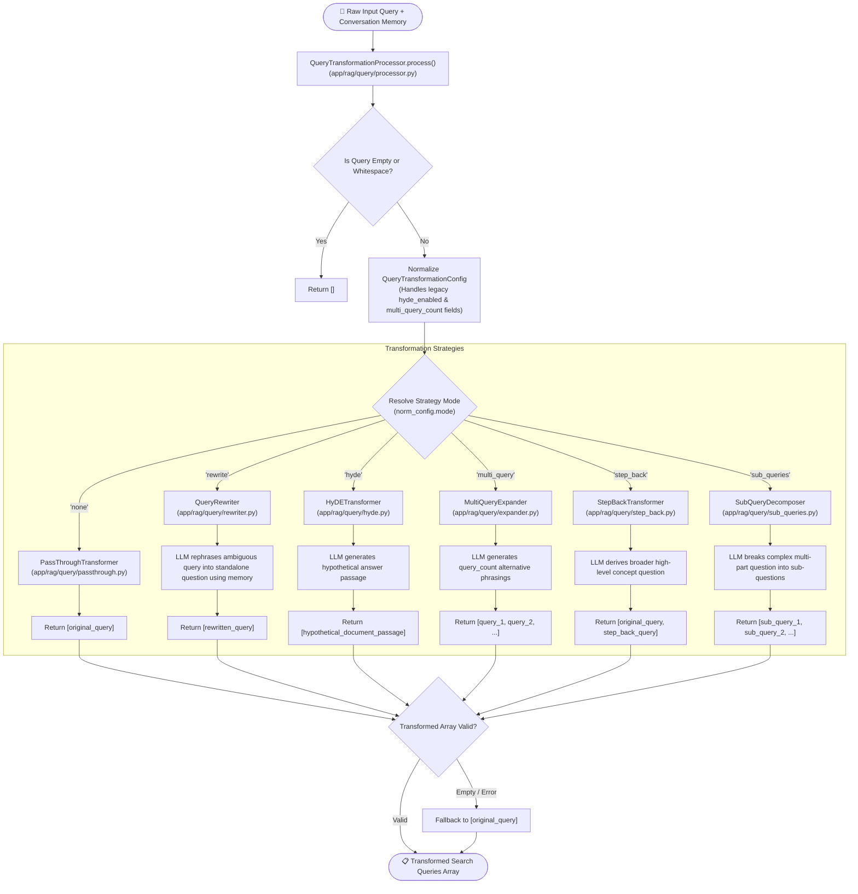

# Query Transformation Pipeline Flow

The **Query Transformation Pipeline** prepares user input for optimal vector search and document retrieval. Coordinated by `QueryTransformationProcessor`, it resolves the active strategy from `ThreadConfig.query_transformation.mode` and generates one or more targeted search query strings.

---

## 📊 Query Transformation Flowchart

---

## 🔬 Detailed Strategy Breakdown

### 1. Configuration & Mode Normalization
- **Schema**: [`QueryTransformationConfig`](../app/schemas/thread.py)
- **Parameters**:
  - `mode`: `"none"` | `"rewrite"` | `"hyde"` | `"multi_query"` | `"step_back"` | `"sub_queries"`
  - `query_count`: Integer between 1 and 10 (default: 3).
  - `include_original`: Boolean (default: `True`).
  - `prompt_template`: Optional custom prompt instructions.
- **Legacy Field Mapping**: Automatically maps legacy boolean/integer settings (`hyde_enabled=True` -> `mode="hyde"`, `multi_query_count > 0` -> `mode="multi_query"`).

---

### 2. Strategy Implementations

#### 1. `none` (PassThrough)
- **Module**: [`app/rag/query/passthrough.py`](../app/rag/query/passthrough.py)
- **Behavior**: Performs no transformation. Returns `[original_query]`.
- **Use Case**: Fast retrieval, direct keyword search, or minimal latency requirements.

#### 2. `rewrite` (Query Rewriter)
- **Module**: [`app/rag/query/rewriter.py`](../app/rag/query/rewriter.py)
- **Behavior**: Analyzes conversation memory and reformulates conversational or ambiguous queries into standalone search questions (e.g., *"What did he say about it?"* -> *"What did Einstein say about special relativity in 1905?"*).
- **Use Case**: Multi-turn chat threads containing pronouns, indirect context references, or ellipsis.

#### 3. `hyde` (Hypothetical Document Embeddings)
- **Module**: [`app/rag/query/hyde.py`](../app/rag/query/hyde.py)
- **Behavior**: Prompts the LLM to generate a hypothetical "ideal answer" document passage. The vector embedding of this fake answer is then used during dense vector retrieval to match real documents with similar semantic structure.
- **Use Case**: Abstract questions where query syntax differs significantly from document passage syntax.

#### 4. `multi_query` (Multi-Query Expander)
- **Module**: [`app/rag/query/expander.py`](../app/rag/query/expander.py)
- **Behavior**: Prompts the LLM to generate `query_count` distinct query variants from different viewpoints, phrasing styles, or vocabulary choices.
- **Use Case**: Overcoming single-query keyword sensitivity and maximizing retrieval recall.

#### 5. `step_back` (Step-Back Prompting)
- **Module**: [`app/rag/query/step_back.py`](../app/rag/query/step_back.py)
- **Behavior**: Derives a higher-level step-back concept question (e.g., *"Why did my FastAPI endpoint throw 422?"* -> *"How does FastAPI request validation handle missing body parameters?"*) and returns both original and step-back queries.
- **Use Case**: Technical troubleshooting, deep reasoning, and retrieving underlying domain principles.

#### 6. `sub_queries` (Sub-Query Decomposition)
- **Module**: [`app/rag/query/sub_queries.py`](../app/rag/query/sub_queries.py)
- **Behavior**: Decomposes compound or multi-part questions into individual atomic sub-questions (e.g., *"Compare PostgreSQL and MongoDB scaling"* -> `["PostgreSQL scaling capabilities", "MongoDB scaling capabilities"]`).
- **Use Case**: Comparative analysis and complex multi-part prompts.

---

### 3. Fallback & Safety Guarantees
- If a strategy encounters an LLM provider error or returns an empty list, `QueryTransformationProcessor.process()` falls back to returning `[original_query]` so the retrieval pipeline is never starved of search input.
