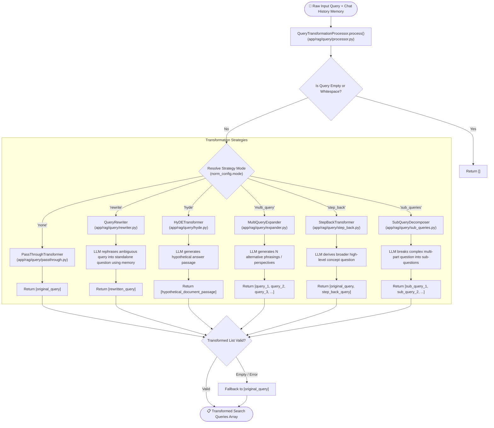

# Query Transformation Pipeline Flow

The **Query Transformation Pipeline** prepares user input for optimal vector search and document retrieval. Coordinated by `QueryTransformationProcessor`, it resolves the active strategy from `ThreadConfig.query_transformation.mode` and generates one or more targeted search query strings.

---

## 📊 Query Transformation Flowchart

---

## 🔬 Detailed Strategy Breakdown

### 1. `none` (PassThrough)
- **Module**: [`app/rag/query/passthrough.py`](../app/rag/query/passthrough.py)
- **Behavior**: No transformation performed. Passes raw query directly to retrieval engines.
- **Use Case**: Fast retrieval, simple keyword searches, or low latency requirements.

### 2. `rewrite` (Query Rewriter)
- **Module**: [`app/rag/query/rewriter.py`](../app/rag/query/rewriter.py)
- **Behavior**: Evaluates conversation history and reformulates conversational or ambiguous queries (e.g., *"What did he say about it?"* -> *"What did Einstein say about special relativity in 1905?"*).
- **Use Case**: Multi-turn chat threads with pronouns or indirect context references.

### 3. `hyde` (Hypothetical Document Embeddings)
- **Module**: [`app/rag/query/hyde.py`](../app/rag/query/hyde.py)
- **Behavior**: Uses the LLM to write a fake/hypothetical "ideal answer" document. The vector embedding of this fake answer is then used to search for real documents with similar semantic structure.
- **Use Case**: Abstract questions where query syntax differs greatly from document answer syntax.

### 4. `multi_query` (Multi-Query Expander)
- **Module**: [`app/rag/query/expander.py`](../app/rag/query/expander.py)
- **Behavior**: Prompts the LLM to generate $N$ distinct query variants from different viewpoints or vocabulary choices.
- **Use Case**: Overcoming keyword sensitivity and boosting retrieval recall.

### 5. `step_back` (Step-Back Prompting)
- **Module**: [`app/rag/query/step_back.py`](../app/rag/query/step_back.py)
- **Behavior**: Derives a higher-level, step-back concept query (e.g., *"Why did my Fastapi endpoint throw 422?"* -> *"How does FastAPI request validation handle missing parameters?"*).
- **Use Case**: Technical troubleshooting, deep reasoning, and high-level principle retrieval.

### 6. `sub_queries` (Sub-Query Decomposition)
- **Module**: [`app/rag/query/sub_queries.py`](../app/rag/query/sub_queries.py)
- **Behavior**: Decomposes complex compound questions into individual sub-questions (e.g., *"Compare PostgreSQL and MongoDB scaling"* -> `["PostgreSQL scaling capabilities", "MongoDB scaling capabilities"]`).
- **Use Case**: Comparative analysis and complex multi-part prompts.
