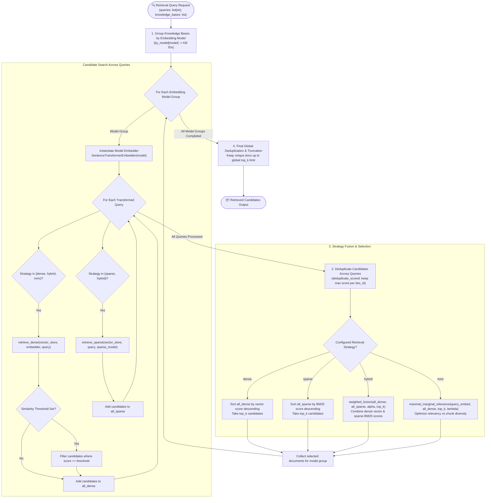

# Retrieval Workflow Pipeline Flow

The **Retrieval Workflow Pipeline** coordinates document retrieval across multiple Knowledge Bases. It supports single and hybrid retrieval strategies, model-based grouping, query candidate aggregation, score fusion, and diversity-aware candidate selection (MMR).

---

## 📊 Retrieval Workflow Flowchart

---

## 🔬 Detailed Strategy Breakdown

### 1. Dense Vector Retrieval (`dense`)
- **Module**: [`app/rag/retrieval/dense.py`](../app/rag/retrieval/dense.py)
- **Algorithm**: Performs cosine similarity / inner product vector search against PostgreSQL `pgvector` index using query embeddings generated by `SentenceTransformerEmbedder`.
- **Filtering**: Filters candidates by `knowledge_base_id` and optional `similarity_threshold`.

### 2. Sparse Keyword Retrieval (`sparse`)
- **Module**: [`app/rag/retrieval/sparse.py`](../app/rag/retrieval/sparse.py)
- **Algorithm**: Executes full-text BM25 keyword search using PostgreSQL `tsvector` / text search configurations. Ideal for exact keyword, code, or identifier matching.

### 3. Hybrid Weighted Fusion (`hybrid`)
- **Module**: [`app/rag/retrieval/fusion.py`](../app/rag/retrieval/fusion.py)
- **Algorithm**: Merges dense vector and sparse BM25 candidate rankings using parameter $\alpha \in [0, 1]$:
  $$\text{Score}_{\text{hybrid}} = \alpha \cdot \text{Score}_{\text{dense}} + (1 - \alpha) \cdot \text{Score}_{\text{sparse}}$$
- Balances semantic context understanding with exact lexical keyword matching.

### 4. Maximal Marginal Relevance (`mmr`)
- **Module**: [`app/rag/retrieval/mmr.py`](../app/rag/retrieval/mmr.py)
- **Algorithm**: Iteratively selects documents that maximize query relevance while minimizing redundancy with already selected chunks:
  $$\text{MMR} = \arg\max_{D_i \in R \setminus S} \left[ \lambda \cdot \text{Sim}_1(D_i, Q) - (1 - \lambda) \max_{D_j \in S} \text{Sim}_2(D_i, D_j) \right]$$
- Controlled by `mmr_lambda` (tradeoff parameter between relevance and diversity).
