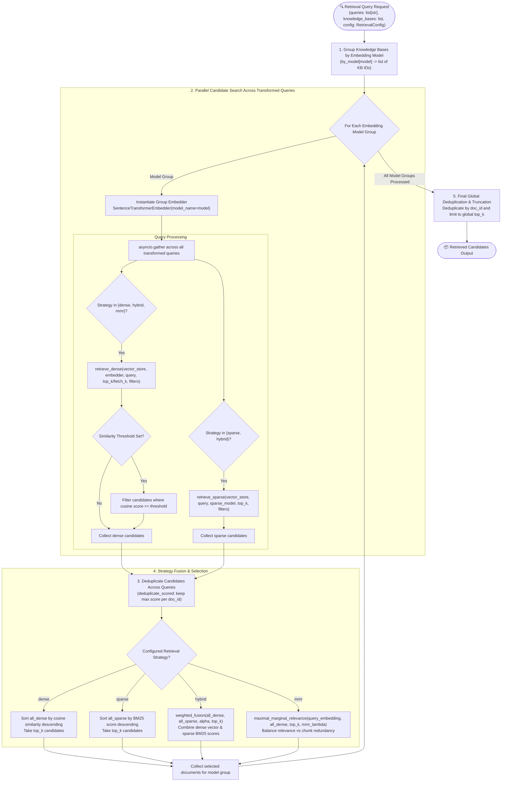

# Retrieval Workflow Pipeline Flow

The **Retrieval Workflow Pipeline** coordinates multi-Knowledge-Base document search. It supports single and hybrid search strategies, embedding model grouping, candidate query aggregation, score fusion, and Maximal Marginal Relevance (MMR) candidate diversity optimization.

---

## 📊 Retrieval Workflow Flowchart

---

## 🔬 Detailed Strategy Breakdown

### 1. Model Grouping & Candidate Gathering
- **Module**: [`app/rag/retrieval/workflow.py`](../app/rag/retrieval/workflow.py)
- **Action**:
  - Groups Knowledge Bases attached to the thread by their embedding model (`by_model[model]`).
  - Instantiates `SentenceTransformerEmbedder` once per model group.
  - Executes candidate retrieval in parallel across all transformed queries using `asyncio.gather`.
  - Filters searches by `knowledge_base_id` array.

### 2. Dense Vector Search (`dense`)
- **Module**: [`app/rag/retrieval/dense.py`](../app/rag/retrieval/dense.py)
- **Algorithm**: Performs cosine similarity / inner product vector search against PostgreSQL `pgvector` index using query embeddings generated by `SentenceTransformerEmbedder`.
- **Filtering**: Filters candidates by `similarity_threshold` when configured (`RetrievalConfig.similarity_threshold`).

### 3. Sparse Keyword Search (`sparse`)
- **Module**: [`app/rag/retrieval/sparse.py`](../app/rag/retrieval/sparse.py)
- **Algorithm**: Executes full-text BM25 keyword search using PostgreSQL `tsvector` / text search capabilities (`RetrievalConfig.sparse_model="bm25"`). Ideal for exact term, code, product code, or identifier matching.

### 4. Hybrid Weighted Score Fusion (`hybrid`)
- **Module**: [`app/rag/retrieval/fusion.py`](../app/rag/retrieval/fusion.py)
- **Algorithm**: Merges dense vector and sparse BM25 candidate rankings using parameter $\alpha \in [0, 1]$ (`RetrievalConfig.alpha`):
  $$\text{Score}_{\text{hybrid}} = \alpha \cdot \text{Score}_{\text{dense}} + (1 - \alpha) \cdot \text{Score}_{\text{sparse}}$$
- Normalizes dense and sparse scores into $[0, 1]$ before combining to balance semantic context understanding with exact lexical keyword matching.

### 5. Maximal Marginal Relevance (`mmr`)
- **Module**: [`app/rag/retrieval/mmr.py`](../app/rag/retrieval/mmr.py)
- **Algorithm**: Iteratively selects documents that maximize query relevance while minimizing redundancy with already selected chunks:
  $$\text{MMR} = \arg\max_{D_i \in R \setminus S} \left[ \lambda \cdot \text{Sim}_1(D_i, Q) - (1 - \lambda) \max_{D_j \in S} \text{Sim}_2(D_i, D_j) \right]$$
- Driven by `RetrievalConfig.mmr_lambda` ($\lambda \in [0, 1]$, balancing relevance vs diversity) and `fetch_k` candidate pool size.

### 6. Candidate Deduplication & Global Truncation
- **Deduplication**: `deduplicate_scored()` keeps the highest-scoring occurrence of each document chunk across queries.
- **Global Truncation**: After collecting results across all embedding model groups, performs a final global deduplication pass by `doc_id` and clips the output array to `RetrievalConfig.top_k`.
